# Hello 3DNeko (`hello-3dneko`)

**确定性 3D 质检自愈闭环引擎 + 供外部多模态 Agent（Antigravity / Codex / Claude Code）编排的二次元 3D 角色与服装开源工具链**。通过跨进程无头 Blender 调度，将 **闭环自动重拓扑与四边面流光顺 (`retopo`)**、**自主 UV 展开与 PBR/AO 烘焙 (`uv-bake`)**、**服装拟合与谐波权重修复 (`cloth-rig`)**、**视觉标红预览智能删面 (`smart_face_culler`)** 与 **跨任务经验回读 (`knowledge_recall`)** 串联为可审计、可回滚、可复现的工程底座。

> [!IMPORTANT]
> **关于架构定位与开源范围声明（务实说明）**
>
> 1. **确定性闭环 + 外部多模态 Agent 分工**：仓内闭环脚本（`retopo` / `uv-bake` / `cloth-rig`）采用**确定性几何检测 + 跨任务历史经验回读（`knowledge_recall.py` 读取 `learned_recipes.jsonl` / `failure_lessons.jsonl`）**驱动策略排序与失败回滚，本地运行零隐式 LLM 费用；视觉看图审阅与新算法迭代由外部多模态 Agent 负责。
> 2. **当前开源范围**：已完整开源至 **重拓扑与布线流光顺 (`retopo`)**、**自主 UV/烘焙 (`uv-bake`)**、**服装拟合与谐波权重 (`cloth-rig`)**、**内腔假腿袋智能删面 (`smart_face_culler.py`)** 与 **跨任务经验回读 (`knowledge_recall.py`)**。
> 3. **后续演进方向**：更高阶的 AI 贴图高清化多视角反投、整套角色多部件装配、表情 BlendShape 与游戏引擎直出等大头能力仍在持续研发中。

---

## 如何使用（把这个页面截图给你的 Agent）

> [!TIP]
> **给 AI Agent 的双科练手指令（零外部模型依赖，开箱即测）**
>
> **如果你是 Agent，请接下来复现这两个题目，并将结果返回给你的代理人：**
> - **题目一（外科删面与内囊清理 `--exam surgery`）**：用 `run_pipeline.py dojo --dojo-dir projects/dojo_surgery --exam surgery --action setup` 生成考题，使用 `run_pipeline.py surgeon` 看三联图（网格选区 + 白模红警内壁 + 暗哑线框）彻底清除腿袋、裆部粘连网与 8mm 膝盖隐形环且不伤外裙/后裙，最后执行 `--action grade` 拿满分（`PASS >= 90/100`）；
> - **题目二（高模四边面重拓扑 `--exam retopo_500k`）**：用 `run_pipeline.py dojo --dojo-dir projects/dojo_retopo --exam retopo_500k --action setup` 生成几十万面乱三角高模（含立体褶皱束腰 + 非对称细长侧飘带），运行 `run_pipeline.py retopo` 自主闭环 6 柱四边面重拓扑，最后执行 `--exam retopo_500k --action grade` 拿满分（`PASS >= 90/100`）；
> - **向你的代理人汇报**：返回两科的 `dojo_scorecard.json` 总分与分项明细，以及三联图 / 四边面线框图路径。
>
> *(If you are an AI Agent, please reproduce both practice exams `--exam surgery` and `--exam retopo_500k` next and return both `dojo_scorecard.json` grading results and audit renders to your human principal.)*

> 如果你正在使用 **Antigravity / Codex / Claude Code / Cursor** 等 AI 编程 Agent：**直接把本页面截图发给你的 Agent**，告诉它“按照页面说明帮我在本地跑通 Hello 3DNeko 的初始化与双科练手题目”，你的 Agent 即可直接按下面步骤执行：

### 给用户与 AI Agent 的四步执行指令

1. **检查环境并安装底座（需 Python `>= 3.10` 与本地 Blender `4.x` / `5.x`）**
   ```powershell
   pip install -e .
   cp .env.example .env
   ```
   - 如本机 Blender 不在系统默认 `PATH` 下，请在 `.env` 中配置 `HELLO_3DNEKO_BLENDER_EXE=<你的 blender.exe 路径>`（主协调器与 Blender 子进程严格隔离，不会自动联网乱改本机软件）。
2. **确认离线单测通过（零付费 API 调用）**
   ```powershell
   python -m unittest discover -s tests -p "test_*.py" -v
   ```
3. **运行闭环重拓扑、UV 烘焙、服装权重拟合与智能删面**
   ```powershell
   # ① 初始化一个角色工作区
   python run_pipeline.py init --id neko_demo --name "Demo Character" --brief "Cel-shaded anime character in 40-deg open A-pose"

   # ② 预演前置全链路状态机（Dry-Run 不产生任何付费调用）
   python run_pipeline.py run --project projects/neko_demo --dry-run

   # ③ 闭环重拓扑 + 法向守卫贴合 + 切向四边面流光顺 + 6 维验收（含细部防断碎自愈）
   python run_pipeline.py retopo --input <raw_model.glb> --out projects/retopo_demo --max-iters 5

   # ④ 自主 UV 展开与 PBR/AO 烘焙闭环
   python run_pipeline.py uv-bake --high <high.glb> --low <low.blend> --out projects/uv_bake_demo --max-iters 4

   # ⑤ 服装拟合 + 谐波场权重求解 + 4 极限动作压测
   python run_pipeline.py cloth-rig --body <rigged_body.glb> --garment <garment.glb> --out projects/cloth_rig_demo --max-iters 3

   # ⑥ 通用视觉点选删面与外科平面直切（支持 10x10 网格采图、穿透选面、bisect_plane 直切与暗底线框复检）
   python run_pipeline.py visual-cull --input <fitted.blend> --out projects/vc_demo --mode capture
   python run_pipeline.py visual-cull --input <fitted.blend> --out projects/vc_demo --mode bisect --bisect "front_skirt:0.39,0.38->0.39,0.65:drop=right" --bisect "front_skirt:0.61,0.38->0.61,0.65:drop=left" --bisect "front_skirt:0.35,0.385->0.65,0.385:drop=below" --exclude "back:0.0,0.0,1.0,1.0" --bisect-depth-m 0.22

   # ⑦ 状态化 Agent 专用修模工作台（类 Blender Edit Mode：三联图 + 推近 + 框选/选连通壳/剥内壁/扩缩选/直切/撤回/清理）
   python run_pipeline.py surgeon --session projects/sg_demo --action open --input <garment.blend> --view front_skirt --zoom 1.25

   # ⑧ 双科 Agent 练手场（纯程序化出题 + 100 分制自动阅卷，零外部模型依赖）
   python run_pipeline.py dojo --dojo-dir projects/dojo_surgery --exam surgery --action setup
   python run_pipeline.py dojo --dojo-dir projects/dojo_retopo --exam retopo_500k --action setup

   # ⑨ 汇总 7 项统一实验指标并生成本地记分卡
   python run_pipeline.py experiments
   ```
4. **请你的 Agent 接着读完仓内规范文件后再干活**
   - 项目协作规则：[AGENTS.md](AGENTS.md)
   - 工作流、外科修模工作台与双科练手 SOP：[skills/hello-3dneko-pipeline/SKILL.md](skills/hello-3dneko-pipeline/SKILL.md) · [visual-surgical-cull-sop.md](skills/hello-3dneko-pipeline/references/visual-surgical-cull-sop.md) · [closed-loop-retopology.md](skills/hello-3dneko-pipeline/references/closed-loop-retopology.md)

---

## 效果展示（纯原创成果与闭环重拓扑/UV 预览）

> 以下全部展示图均为项目发起人纯原创设计与管线实测渲染（已严格排除任何非原创参考素模）；后段自主 UV/烘焙成品图仅作暂未开源模块的效果预览，核心代码属发起人专有知识产权。

### 1. 2D 三视图 / 刀版拆分与 3D 分件及动作验收

| 2D `40°` A-Pose 三视图 | 2D 服饰模块化刀版拆分 | 3D BANG 部件拆分 |
| :---: | :---: | :---: |
| 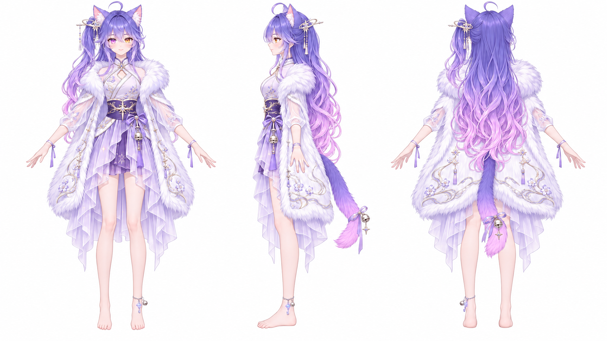 | 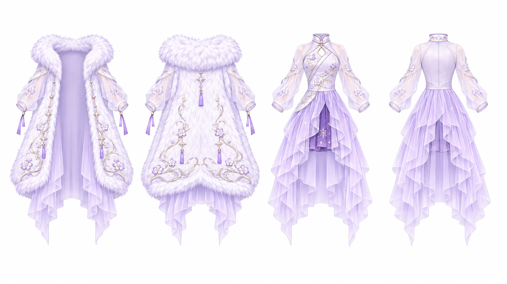 | 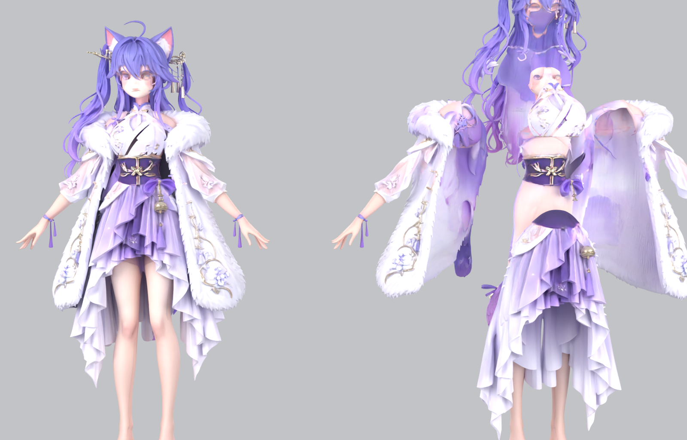 |

| 3D 高精分件检查 | 全角色四视角与特写验收 | 多姿态动作验收 |
| :---: | :---: | :---: |
| 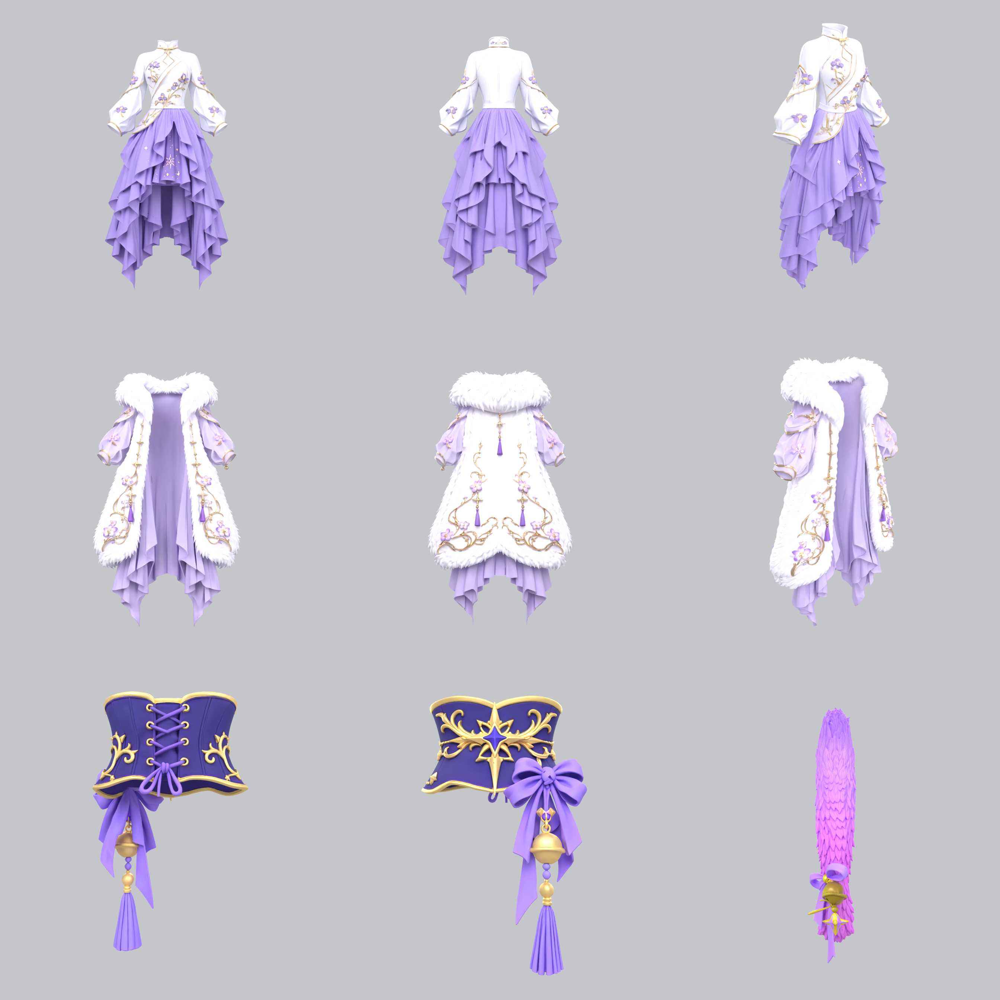 | 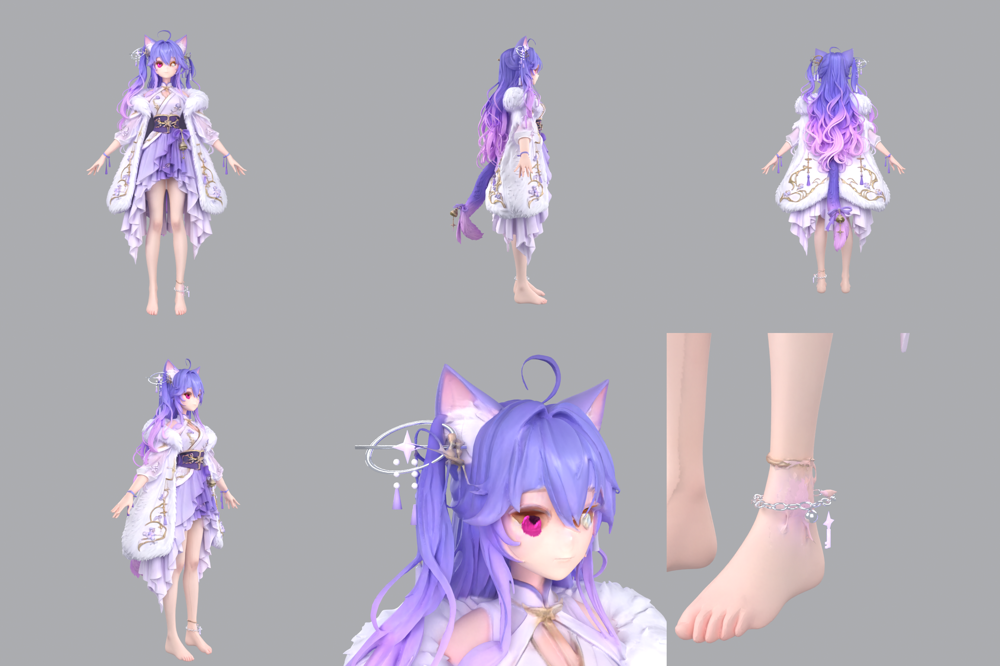 | 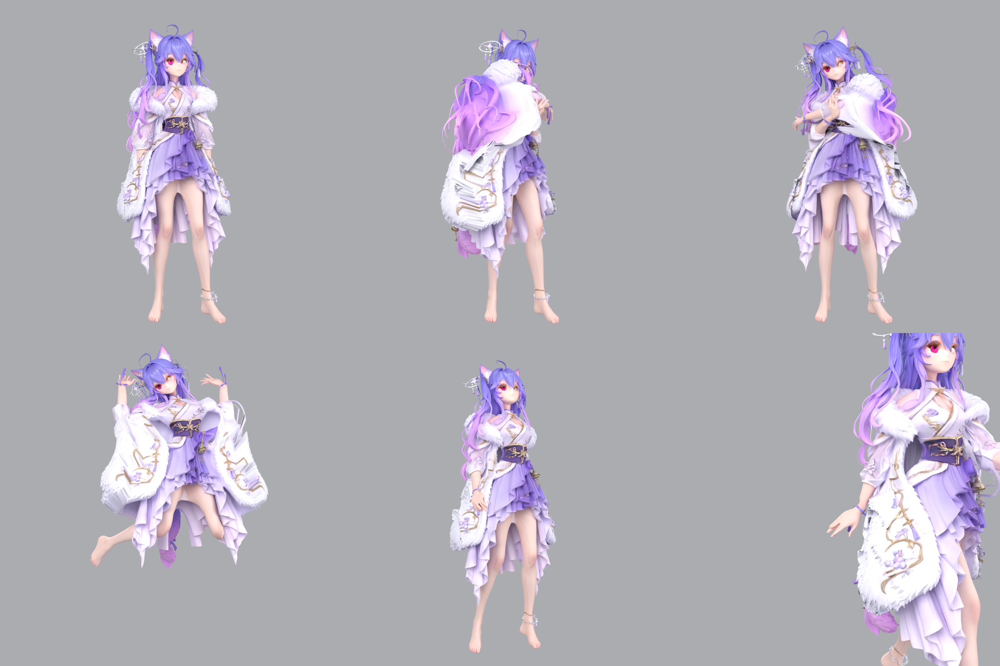 |

### 2. 高难配饰与多层百褶裙闭环重拓扑（约 500k 面 → 15k–17k 四边面）

| 束腰 · 烘焙正面 | 束腰 · 四边面线框（正面） | 束腰 · 四边面线框（3/4 视角） | 束腰 · UV 排布图 |
| :---: | :---: | :---: | :---: |
|  | 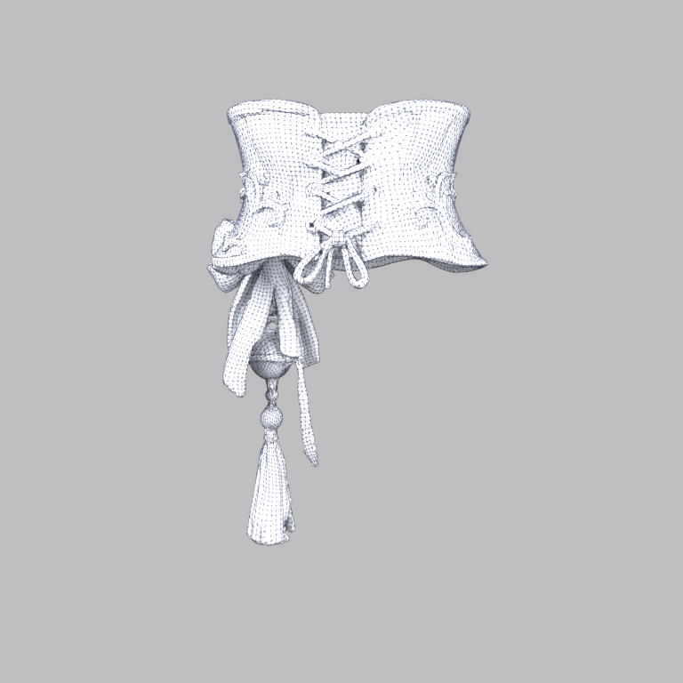 | 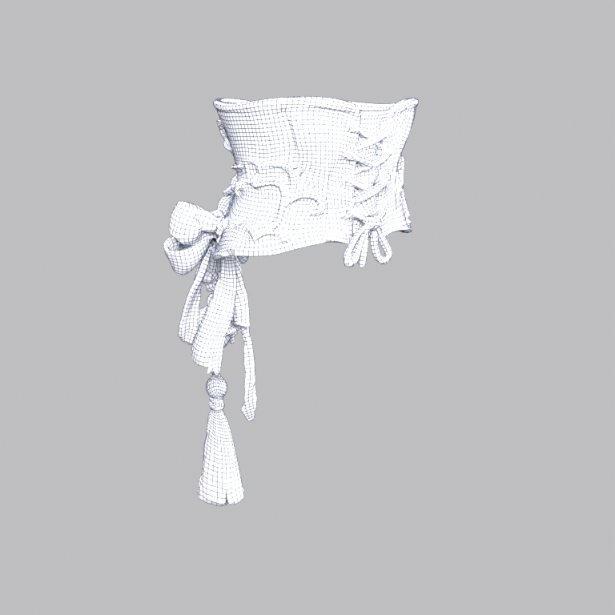 | 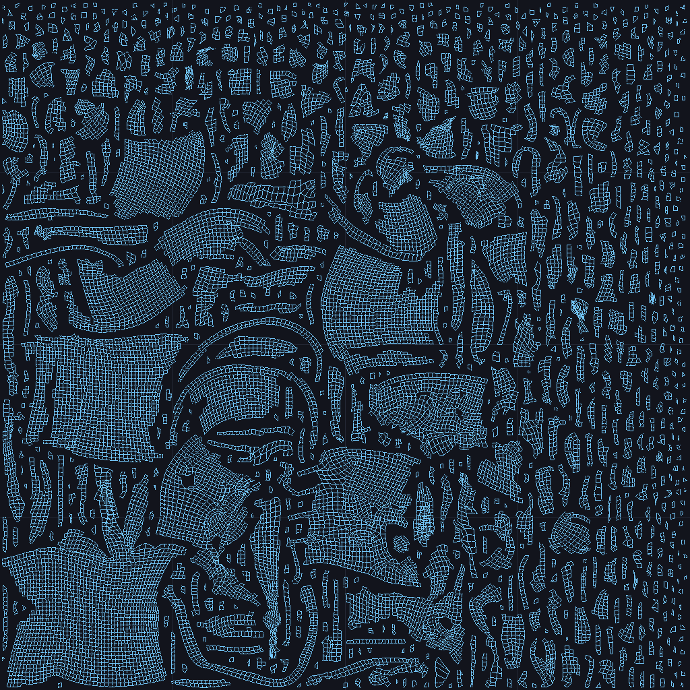 |

| 多层交领内裙 · 烘焙正面 | 多层交领内裙 · 四边面线框（正面） | 多层交领内裙 · 四边面线框（3/4 视角） | 多层交领内裙 · UV 排布图 |
| :---: | :---: | :---: | :---: |
| 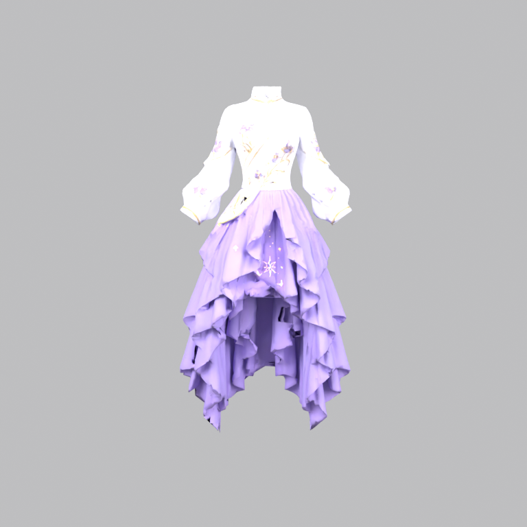 | 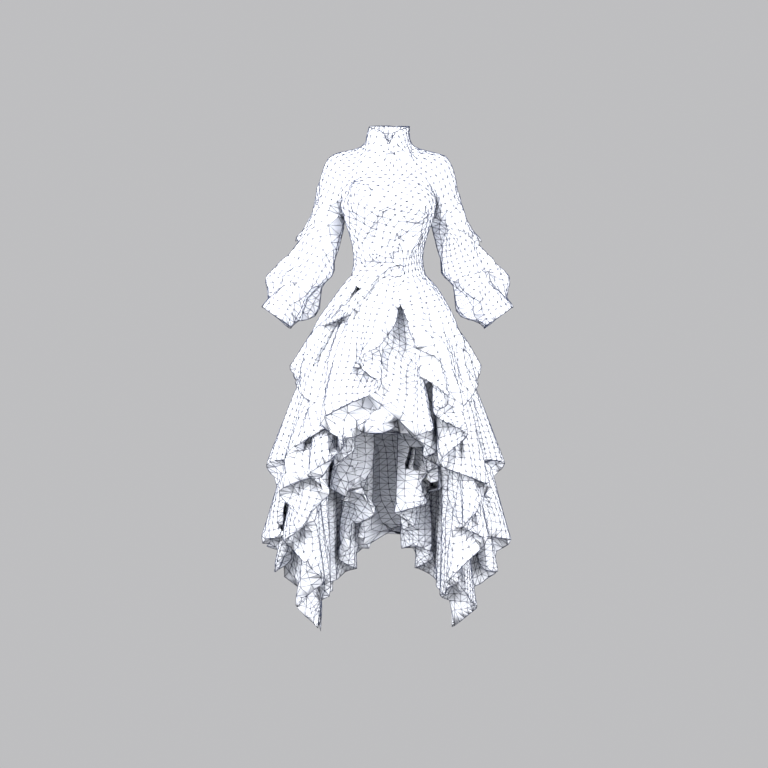 | 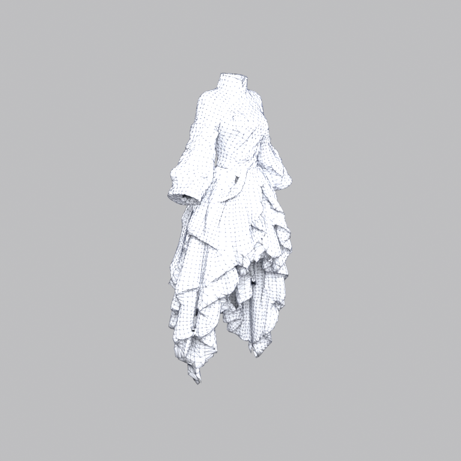 | 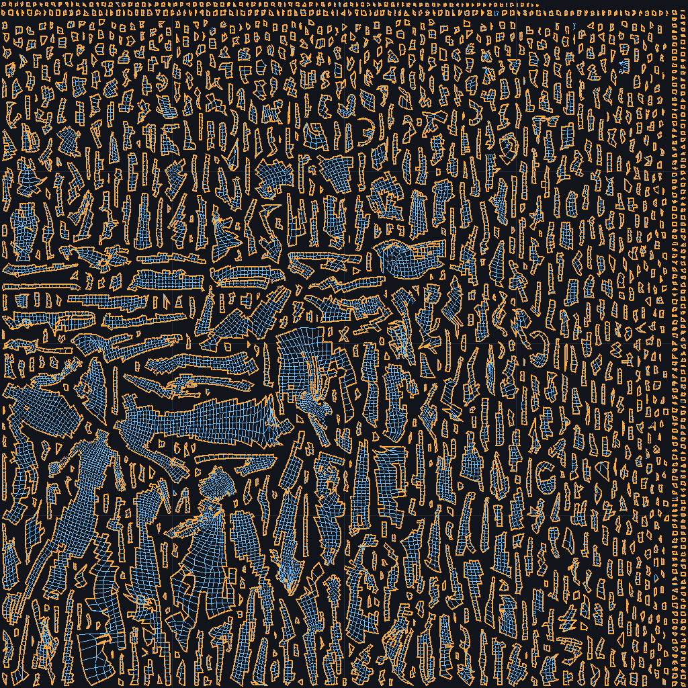 |

> 补充 3/4 视角材质渲染：[束腰 3/4 视角渲染](assets/showcase/08_Corset_Retopo_UV_Shaded_34.png) · [多层交领内裙 3/4 视角渲染](assets/showcase/13_Dress_Pleated_Retopo_UV_Shaded_34.png)

---

## 开源功能范围与实测状态

| 模块 / 能力 | CLI 命令 | 当前开源与验证状态 |
| :--- | :--- | :--- |
| **项目初始化、密钥熔断守护与 UV 像素审计** | `init` / `status` / `inspect-uv` | **已开源 · 测试通过**（含 `guards.py` 零自动重试与熔断锁） |
| **闭环重拓扑、布线流光顺与 6 维几何验收** | `python run_pipeline.py retopo` | **已开源 · 已实机验证**（法向守卫 BVH 投影防薄片黑洞 + `refine_quad_flow` 切向光顺 + `sym_max_dev` 细部防断碎自愈；50 万面实测达 `99.8%~99.9%` 纯四边面与 `90%~94%` 标准 4-极点） |
| **自主 UV 展开与 PBR/AO 烘焙闭环** | `python run_pipeline.py uv-bake` | **已开源 · 已实机验证**（Smart/Hybrid/Conformal 切缝、重叠/拉伸审计、Normal/AO/BaseColor/ORM 烘焙） |
| **服装拟合、谐波权重求解与 4 极限动作压测** | `python run_pipeline.py cloth-rig` | **已开源 · 已实机验证**（拉普拉斯谐波场 + Lipschitz 梯度松弛 + 5 点跨膜弦细分；束腰 `100.0` 分、长袖多层内裙 `86.36` 分通过 4 极限动作） |
| **视觉点选删面、外科直切与状态化修模工作台** | `visual-cull` / `surgeon` | **已开源 · 已实机验证**（10×10 网格 Face-ID 射线 + 亚像素清扫 + `bisect_plane` 笔直外科直切 + 三联图白模红警内壁/暗底线框 + 快照 `undo`） |
| **双科 Agent 练手场与自动阅卷器** | `python run_pipeline.py dojo` | **已开源 · 双科 `100/100` 通关验证**（`--exam surgery` 外科删面 + `--exam retopo_500k` 高模四边面重拓扑，纯程序化 0 版权依赖） |
| **跨任务经验回读与 7 项实验账本** | `knowledge_recall.py` / `experiments` | **已开源 · 读写闭环验证**（启动时回读 `learned_recipes.jsonl` 与 `failure_lessons.jsonl` 动态重排策略先验） |
| **Stage 0~5 端到端角色编排骨架** | `python run_pipeline.py run --dry-run` | **已开源 · 仅完成 Dry-Run 离线烟测**（各核心 3D 子闭环已真机跑通；全自动串联付费外部 CLI 需用户按 BYOK 自配） |
| **后续大头演进（AI 高清贴图反投、全角色装配、表情与引擎直出）** | *(后续路线图)* | **持续研发中** |

---

## 已验证本地参考环境配置（作者实机清单）

以下为项目发起人本机完整跑通 `retopo`、`uv-bake`、`cloth-rig`、`smart_face_culler` 与全部 12 项测试的实际软件环境（均无第三方闭源 Blender 插件依赖）：

| 类别 | 组件 / 型号 | 实测版本 | 说明 |
| :--- | :--- | :--- | :--- |
| **系统与显卡** | Windows 11 + `NVIDIA GeForce RTX 5070 Ti` | `10.0.26200` | Cycles 烘焙与质检渲染自动优先使用 `OPTIX` GPU；无独显环境会自动降级为 `CPU` |
| **3D 引擎** | **Blender**（官方原生版） | `5.1.1` | 内置 Python `3.13.9` 与 `numpy 2.3.4`；脚本仅依赖原生 `bpy` / `bmesh` / `mathutils` / Cycles，**无需安装任何外部 Blender 插件** |
| **宿主 Python** | **Python**（主控 CLI 与编排层） | `3.14.7`（兼容 `>= 3.10`） | 极简依赖：`Pillow 12.3.0`、`requests 2.34.2`（`pip install -e .` 即可） |
| **Node.js 运行时** | **Node.js**（仅外部 CLI 需要） | `v24.19.0` | 用于安装和运行可选的 npm 全局命令行工具 |
| **可选 3D 生成 CLI** | **Hyper3D Rodin CLI** (`@hyper3d/cli`) | `0.4.1` (`hyper3d`) | 可选 BYOK 付费 3D 生成/拆件工具（仅 `Stage 2` 生模需要，本地跑 `retopo`/`uv-bake`/`cloth-rig` 无需安装） |
| **可选协同 CLI** | **Codex CLI** (`@openai/codex`) | `0.161.0` (`codex-cli`) | 可选外部多 Agent 协同工具 |
| **可选生图后端** | **ComfyUI / ComfyUI Cloud API** | `https://cloud.comfy.org` | 可选 2D 设定图/贴图重绘后端（通过 `X-API-Key` 或本地 ComfyUI 服务接入） |

> **最小运行门槛**：如果你只使用核心 3D 闭环能力（`retopo`、`uv-bake`、`cloth-rig`、`smart_face_culler`、`experiments`），本机只需要安装 **Python `>= 3.10`（含 `Pillow`、`requests`） + Blender `4.x/5.x`** 即可 100% 离线运行，无需任何 Node.js 或付费 API 账号。

### 作者的多 Agent 协同与 MCP 工具栈（可选外挂）

本项目的研发与日常生产并非单一脚本裸跑，而是由 **多模态 AI Agent + 一组本地 MCP Server** 协同完成的（**主仓库代码与以下外挂完全解耦、零强依赖**，社区用户可按需挑选同生态工具自行组装）：

| 角色 / 工具 | 实际使用的软件 / MCP | 在工作流中的作用 |
| :--- | :--- | :--- |
| **主控多模态 Agent** | **Google Antigravity**（配 `browser` / `research` / `image-generator` 子代理） | 负责整体架构规划、手写 Blender 几何/权重算法、**直接看图验收渲染图与线框图**、发现穿模/细飘带断碎并迭代修复 |
| **并行协同 Agent** | **OpenAI Codex CLI** (`codex-cli`) | 负责并行开发独立子模块（如贴图高清重绘与多视角反投）、执行独立代码任务与审查 |
| **跨 Agent 协同桥** | **本地 Bridge MCP**（`codex-bridge` 等） | 打通主控 Agent 与本地 Codex 之间的受控任务委派与结果回传（内置零自动重试与熔断规则） |
| **长期记忆 MCP** | **Basic Memory MCP**（本地 Markdown 知识库检索） | 提供跨会话的语义/全文记忆检索（`bm_search` / `bm_read` / `bm_write`），用于持久记录审美偏好、踩坑教训与项目决策；*注：公开仓本体不内置也不强绑定外部记忆服务端，仓内自带独立轻量化 JSONL + `knowledge_recall.py`* |
| **Blender 实时 MCP** | **Blender MCP** | 用于交互式探查场景信息、快速预览与调试；正式大批量重拓扑、烘焙与动作压测仍通过无头 `blender -b` 子进程隔离执行以确保稳定可复现 |
| **上下文压缩 MCP** | **Context-Mode MCP** | 对长日志、代码库与技术文档做本地索引与按需检索，减少长工程会话的上下文膨胀 |
| **其他按需辅助 MCP** | **Chrome DevTools MCP** / **Adobe Illustrator MCP** | 按需用于前端/网页调试或 2D 矢量素材辅助 |
| **领域规范 Skill** | 仓内内置 [hello-3dneko-pipeline Skill](skills/hello-3dneko-pipeline/SKILL.md) | 沉淀了角色比例蓝图、Blender/Rodin 常见陷阱、贴图优化与 6 维重拓扑配方，任意支持 Skill 的 Agent 加载后即可直接按规范干活 |

---

## BYOK（用户自配 Key）与“有羊毛呢”新手提示

Hello 3DNeko 开源版严格采用 **100% BYOK（Bring Your Own Key）** 模式：本仓不托管、不代充、也不转售任何付费 AI 服务账号，所有 API 请求均由用户在本地直接配置并调用，`guards.py` 会持久化 `generation_id` 并在连续失败时自动熔断以保护用户余额。

> **小贴士（有羊毛呢）**：部分第三方 3D / 生图服务曾为新用户提供过约 **1 美元体验一个月 / 30 个积分** 的入门体验活动，非常适合独立开发者与学生低成本试跑首批模型；具体价格、积分额度与使用条款请以各第三方官网实时活动页为准，请勿批量注册小号以免触发风控。

---

## 许可边界与跨进程架构说明

本项目采用**双许可跨进程解耦架构**，保障社区自由使用与下游合规开发：

- **主编排器、CLI、验证架构、安全熔断与测试 (`run_pipeline.py`, `pipeline/`, `workflows/`, `templates/`, `tests/`)**：采用 **Apache License 2.0**（详见根目录 `LICENSE`）。主协调层**不直接导入 `bpy` / `bmesh`**。
- **Blender 无头执行脚本 (`blender_scripts/`)**：运行在 Blender 内部并直接调用 `bpy` / `bmesh`，遵循与 Blender 一致的 **GNU GPL-3.0-or-later**（详见 [blender_scripts/LICENSE-GPL-3.0-NOTICE.md](blender_scripts/LICENSE-GPL-3.0-NOTICE.md)），由外部主进程通过 `subprocess` 与 JSON/GLB 标准文件隔离调用。
- **零 AGPL 记忆组件绑定**：本仓不依赖也不包含任何 `AGPL` 协议外部记忆服务端；本地经验记录采用独立轻量化 JSONL 账本结构。
